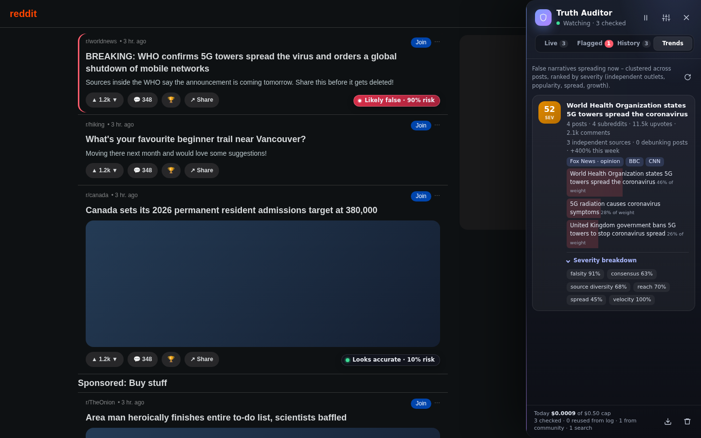

# Reddit Truth Auditor

**Fact-checks the Reddit posts you're looking at, and warns you when something is false or misleading.**

A browser userscript (Tampermonkey / Violentmonkey) that quietly checks posts as you scroll. It:

- extracts the claim, researches it on the web and scores it;
- slides open a side panel when a post looks risky;
- understands sarcasm and satire;
- never pays twice for the same claim, thanks to a local research log.

An optional, self-hostable **community server** lets users pool anonymous reports. The server tracks how often each falsehood spreads, and across which outlets (CNN, Fox News, BBC…). It clusters related lies into **narratives ranked by severity** and shares the agreed list back to every user.

Everything works **offline-first**: analyses are stored locally and reports are published whenever the server is reachable.


## Install

1. Install [Tampermonkey](https://www.tampermonkey.net/) (Chrome, Edge, Firefox, Safari, Opera) or [Violentmonkey](https://violentmonkey.github.io/).
   In Chrome/Edge also switch on **Allow User Scripts** (Extensions → Tampermonkey → Details).
2. **[Install the userscript](https://raw.githubusercontent.com/pjvjay/reddit-truth-auditor/main/dist/reddit-truth-auditor.user.js)** and click *Install*. It updates automatically.
3. Open [reddit.com](https://www.reddit.com). Paste an **OpenAI API key** (plus, optionally, a free [Tavily](https://tavily.com) key for live web research), then press **Save**.

That's it – browse normally. **Alt+Shift+R** toggles the panel.

## Features

| | |
|---|---|
| **Checks what you read** | Posts that stay on screen about a second are checked. The steps are claim extraction, then web research, then a verdict with sources. Works on new Reddit and old.reddit.com. |
| **Configurable alerts** | The panel opens when a post's risk crosses your threshold. Each post gets a status badge. |
| **Humour, sarcasm & satire** | Sarcasm is decoded and the intended meaning is checked. Evident satire is discounted, but satire passed off as news is flagged. |
| **Research log** | Every result is kept locally (30 days). It covers reposts, crossposts, same link, near-identical text, same claim and opposite stance. A History tab and CSV export are included. |
| **Cost controls** | Daily spend cap, dwell time, parallel checks, subreddit filters and pause. Typical cost is about $0.0005 per checked claim with `gpt-4o-mini`. |
| **Community network** *(opt-in)* | Anonymous reports of mistruths go to a shared list, matched **on your device**. Known lies cost few or no tokens. |
| **Narratives** | False claims are clustered into event narratives, weighted by independent outlets, post popularity, spread and growth. View them community-wide or from your own history, offline. |
| **Private by design** | No accounts and no tracking. Keys stay in your userscript manager, the community feature is opt-in, and the exact payload is viewable in Settings. |

More: [userscript guide](docs/userscript.md) · [privacy](docs/privacy.md) · [community API & clustering](docs/community-api.md) · [architecture](docs/architecture.md)



## Community server (optional)

```bash
pip install ./server            # or: docker build -f server/Dockerfile -t rta-community-server .
rta-server --host 0.0.0.0 --port 8080
```

Then point the userscript at it under *Settings → Community network*. See [server/README.md](server/README.md) for deployment and configuration, and [docs/community-api.md](docs/community-api.md) for the protocol, consensus, clustering and severity model.

## Repository layout

```
userscript/          the browser userscript
  src/               ES modules: core, text, reddit, analysis, store, community, insights, pipeline, ui
  build.mjs          esbuild -> dist/
  test/unit/         Node unit tests (node --test)
  test/e2e/          Playwright end-to-end tests (mock Reddit, mock OpenAI/Tavily, real server in-process)
dist/                built, installable userscript (+ .meta.js for update checks)
server/              community API - Python package `rta_server` (FastAPI + SQLite)
spec/                language-neutral contracts: JSON Schemas, outlet registry, cross-language test vectors
batch/               the original command-line batch scripts (finalrun.py pipeline)
docs/                user & developer documentation
```

## Development

```bash
npm install
npm run build          # dist/reddit-truth-auditor.user.js
npm run lint
npm run test:unit      # 35 unit tests (no browser)
npm run test:e2e       # 34 end-to-end scenarios in headless Chromium (needs: pip install playwright fastapi httpx)
npm run test:server    # 32 server tests (pip install -e "server[dev]")
```

See [docs/development.md](docs/development.md) and [CONTRIBUTING.md](CONTRIBUTING.md).

## Limitations

- **AI fact-checks can be wrong.** Treat the panel as a prompt to look closer, and check the cited sources.
- **Web research matters.** Without a Tavily key, verdicts on recent news are marked as unverified rather than false.
- **Text only.** Only post titles and bodies are checked, not comments, images or video.
- **Reddit markup changes.** Reddit changes its page structure from time to time; if badges stop appearing, update the script.

## License

[MIT](LICENSE)
