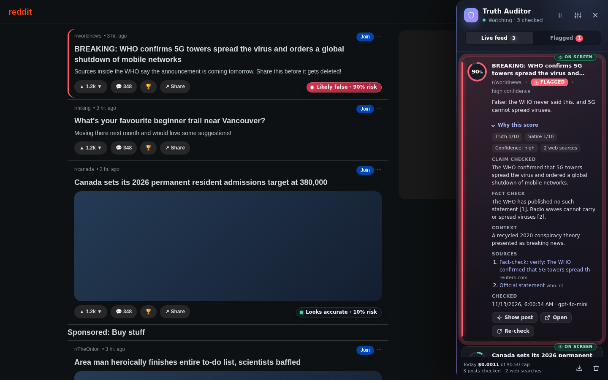
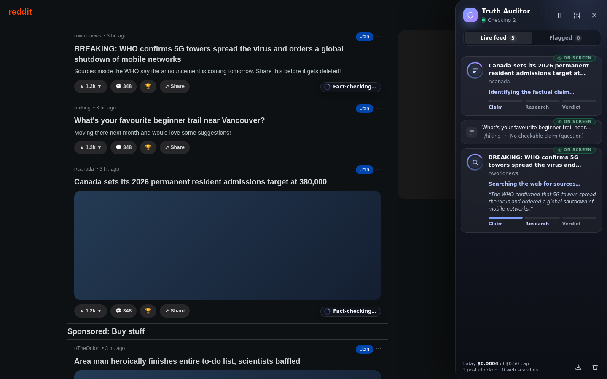
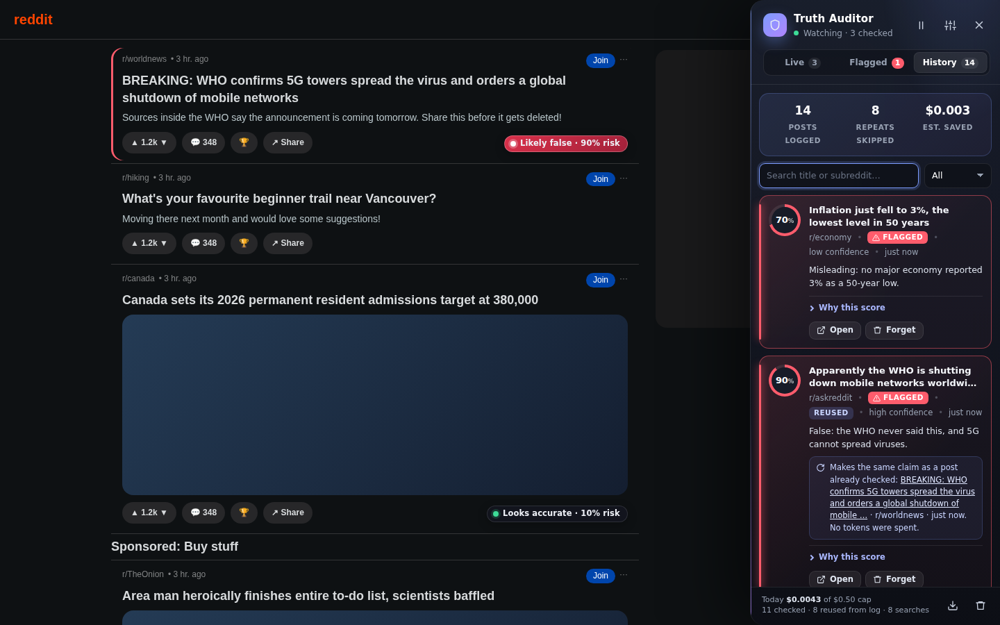

# reddit-truth-auditor

**AI-powered Reddit post truthfulness scorer using GPT-4o-mini and autonomous research agents.**

Available two ways:

- **🧩 Browser userscript (Tampermonkey)** – fact-checks the posts *you are looking at* while you browse Reddit, and slides open a side panel when something looks false or misleading. → [jump to install](#browser-userscript-tampermonkey)
- **🐍 Python batch scripts** – fetch posts from configurable subreddits, score them, and save the worst offenders to a CSV audit log.

---

## Browser userscript (Tampermonkey)



### Install (2 minutes)

1. Install the **[Tampermonkey](https://www.tampermonkey.net/)** extension (Chrome, Edge, Firefox, Safari, Opera). Violentmonkey also works.
   - Chrome/Edge: Tampermonkey also needs **“Allow User Scripts”** switched on (Extensions → Tampermonkey → Details), or *Developer mode* on older versions.
2. Open **[`reddit-truth-auditor.user.js`](https://raw.githubusercontent.com/pjvjay/reddit-truth-auditor/main/userscript/reddit-truth-auditor.user.js)** (raw file). Tampermonkey shows an install page → **Install**.
   *(Or: Tampermonkey dashboard → “+” → paste the file contents → Save.)*
3. Go to [reddit.com](https://www.reddit.com). The panel opens on first run – paste your **OpenAI API key**, optionally a **[Tavily](https://tavily.com) key** for live web research, and press **Save**.

That's it – browse normally.

### What it does

| | |
|---|---|
| **Watches what you read** | A post is checked once it has been on screen for ~1 s (configurable), so fast scrolling doesn't burn credits. Works on the new Reddit UI, `old.reddit.com`, feeds, subreddits and post pages. |
| **Same pipeline as `finalrun.py`** | ① LLM extracts the verifiable claim + search query → ② Tavily web research (the search engine GPT-Researcher uses) → ③ LLM audit returning `truth_score`, `sarcasm_score`, `factual_check`, `context_check`, `verdict`. Opinions, questions and memes are skipped after step ①. |
| **Side panel** | A glassy panel slides in from the right (25 % of the screen, min 340 px) with a spinning card for every post being researched (*Claim → Research → Verdict*), then a risk gauge, verdict, sources and “Show post” for each result. |
| **Configurable risk alert** | `risk = 100 − truth_score × 10`. The panel **auto-opens when a post at or above your threshold is on screen** (default 60 % ⇔ truth ≤ 4/10). Satire/jokes are not flagged by default. |
| **Badges on posts** | Each checked post gets a small pill (*Fact-checking… / Looks accurate / Misleading? / Likely false*), and flagged posts get a red edge. Click a pill to open its card. |
| **Research log – never pays twice** | Every analysed post (scores, verdict, sources) is kept in a local log (30 days / 5,000 posts by default, shared across tabs). Posts already in the log are never re-analysed, and reposts are recognised – see below. A **History** tab lets you browse/search the log and shows how much was saved. |
| **Cost controls** | Daily spend cap (default $0.50), parallel-check limit, pause button, subreddit allow/block lists. Today's spend and reuse count are shown in the panel footer. |
| **CSV export** | Download the research log as CSV (same columns as `final_policy_audit.csv`, plus risk, sources and `reused_from` / `reuse_via`). |



### Research log & duplicate detection

Before a post costs anything it is matched against the log, cheapest check first:

| Tier | Match | Cost |
|---|---|---|
| 0 | **Same post** seen before (any tab, any earlier session) | free |
| 1 | **Crosspost** of a logged post (`crosspost_parent`) | free |
| 1 | **Same link** – URL normalised (tracking params, `www`/`m.`/AMP, `youtu.be`, trailing `/`) plus a loosely similar title | free |
| 1 | **Near-identical text** – title + start of body, word-overlap ≥ the *Duplicate similarity* setting (default 80 %) | free |
| 2 | **Same claim** – after the cheap claim-extraction call the claim is compared with logged claims (word-overlap), and the extraction model is shown up to 5 related earlier claims and asked whether this post makes *materially the same* claim | 1 small call; web research + audit skipped |

Safeguards: two texts are never treated as duplicates if their **numbers differ** (“inflation fell to 1 %” ≠ “… 3 %”) or one is **negated** (“does” ≠ “doesn't”), and very short titles only match word-for-word. Identical posts that appear on screen together are checked once (the second waits for the first).

Reused results are labelled **Reused** with a link to the original post and a **Check anyway** button that ignores the match and runs a full check. The History tab can **Forget** individual entries; *Settings → Advanced → Clear research log* wipes it.



### Settings (⚙ in the panel, or Tampermonkey menu → *Settings…*)

| Setting | Default | Notes |
|---|---|---|
| OpenAI API key | – | Stored in Tampermonkey storage only; never written back into the page. |
| Model / API base URL | `gpt-4o-mini` / OpenAI | Any OpenAI-compatible endpoint (OpenRouter, local Ollama `http://localhost:11434/v1`). |
| Tavily API key | – | Optional. Without it the model's own knowledge is used and it is told to mark unverifiable recent news as *unverified*, not *false*. |
| **Risk threshold** | **60 %** | Slider 5–100 %. Lower = more sensitive. Changing it re-evaluates existing results instantly (no new API calls). |
| Open panel automatically | When a risky post is on screen | or *whenever posts are being researched*, or *never* (the launcher tab just shows a red count). |
| Don't flag satire | on | Posts with `sarcasm_score ≥ 7` are shown as *Likely satire*. |
| Check after on-screen for | 1200 ms | Dwell time before a post is checked. |
| Parallel checks | 2 | |
| Daily spend cap | $0.50 | 0 = no cap. Estimated from token usage and the per-token prices under *Advanced*. |
| Reuse verdicts for near-duplicates | on | Crossposts, same link, near-identical text, same claim. |
| Duplicate similarity | 80 % | 50–100 %. Higher = stricter; 100 % = identical wording only. |
| Keep research log | 30 days | Entries older than this are re-analysed if seen again. |
| Max posts in log | 5,000 | Oldest entries are dropped first. |
| Only / never these subreddits | – | Comma-separated, like `TARGET_SUBS` in the Python scripts. |
| Reference facts | – | Ground-truth notes injected into the audit prompt (the "MASTER REFERENCE" idea from `test.py`). |

Shortcuts: **Alt+Shift+R** toggles the panel, **Esc** closes it.

### Cost

Each post with a checkable claim uses two `gpt-4o-mini` calls (roughly $0.0003–0.0007 together) plus one Tavily search (the free tier currently includes 1,000 searches/month). Posts without a claim cost one small call. Posts already in the research log, crossposts, same-link and near-identical reposts cost nothing; same-claim reposts cost only the small extraction call – so the default $0.50/day cap covers around 1,000 checked posts.

### Privacy & limitations

- Post text is sent to your LLM provider (and the search query to Tavily). Nothing else leaves your browser; there is no server. The research log lives in your userscript manager's local storage.
- LLM fact-checking can be wrong – treat the panel as a prompt to look closer, not a final ruling. Check the sources under *Why this score*.
- A reused verdict is as old as the original check. For fast-moving stories, lower *Keep research log* or use **Check anyway**.
- Only post titles/bodies are checked (not comments, images or videos). Link posts are judged on their headline.
- Reddit changes its markup from time to time; if badges stop appearing, update the script.

### Development / tests

The userscript is a single dependency-free file: `userscript/reddit-truth-auditor.user.js`.
An end-to-end test suite runs it in headless Chromium against mock Reddit pages (new + old UI) with OpenAI/Tavily mocked – no keys or network needed:

```bash
pip install playwright && playwright install chromium
python userscript/tests/test_userscript.py      # screenshots saved to userscript/tests/screenshots/
```

---

## Python batch scripts

### Features

- **Multi-stage analysis** — factual check, context check, and verdict summary per post
- **Autonomous deep research** — `finalrun.py` uses [GPT-Researcher](https://github.com/assafelovic/gpt-researcher) to conduct real web research before scoring
- **LangChain pipeline** — structured JSON output via prompt chaining and `JsonOutputParser`
- **Cost tracking** — token usage and USD cost logged per run
- **CSV audit log** — scored posts saved with date, subreddit, score, reasoning, and URL

### Requirements

- Python 3.10+
- OpenAI API key
- (For `finalrun.py`) `TAVILY_API_KEY` for GPT-Researcher web search

### Quick Start

```bash
git clone https://github.com/pjvjay/reddit-truth-auditor
cd reddit-truth-auditor

python -m venv venv
source venv/bin/activate
pip install -r requirements.txt

cp .env.example .env
# Add your OPENAI_API_KEY (and TAVILY_API_KEY for finalrun.py)

python finalrun.py
```

### Scripts

Three iterations, each more powerful than the last:

#### `run.py` — Basic scorer
Fetches posts from a subreddit and scores them 0–10 for truthfulness using a single GPT-4o-mini prompt. Outputs results to `reddit_truth_audit.csv`.

#### `run2.py` — Multi-component reasoning
Breaks analysis into three structured components returned as JSON:
- `factual_check` — verifies specific numbers, laws, and claims
- `context_check` — evaluates how the post fits the current policy landscape
- `verdict_summary` — one-sentence conclusion

Targets configurable subreddits (default: Canadian immigration/policy communities).

#### `finalrun.py` — Deep research pipeline *(recommended)*
Uses [GPT-Researcher](https://github.com/assafelovic/gpt-researcher) to autonomously research each post's core claim on the web before scoring. Pipeline:

```
Reddit post
    ↓
LangChain: extract verifiable claim + search query
    ↓
GPT-Researcher: autonomous web research (5–10 sources)
    ↓
LangChain: audit claim against research report
    ↓
JSON output: truth_score, sarcasm_score, factual_check, verdict
    ↓
CSV: final_policy_audit.csv
```

### Configuration

Edit the `TARGET_SUBS` list at the top of each script:

```python
TARGET_SUBS = ['lmiascams', 'destiny', 'canadian', 'askcanada', 'vancouverjobs']
```

Environment variables (`.env`):
```
OPENAI_API_KEY=sk-...
TAVILY_API_KEY=tvly-...   # required for finalrun.py
```

### Output

CSV columns (finalrun.py):

| Column | Description |
|---|---|
| `date` | Run date |
| `score` | Truthfulness score 0–10 (lower = less truthful) |
| `subreddit` | Source subreddit |
| `title` | Post title |
| `factual_check` | Specific fact verification from research |
| `context_check` | How claim fits current policy/news context |
| `verdict` | One-sentence final assessment |
| `url` | Direct link to Reddit post |

## Project Structure

```
reddit-truth-auditor/
├── userscript/
│   ├── reddit-truth-auditor.user.js   # Tampermonkey userscript (browser version)
│   ├── docs/                          # screenshots
│   └── tests/                         # Playwright end-to-end tests + mock Reddit pages
├── run.py            # Basic GPT scorer
├── run2.py           # Multi-component reasoning scorer
├── finalrun.py       # Full research pipeline (recommended)
├── requirements.txt
├── .env.example
└── *.csv             # Audit output (gitignored)
```
