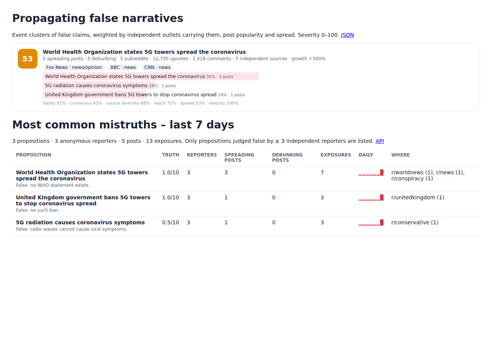

# Community API

A small reference service that lets Reddit Truth Auditor users **pool what they find**:

- userscripts publish **anonymous reports** of claims they judged false,
- the server merges them into canonical **propositions** and counts how often each mistruth is spread (and debunked), where and how fast,
- it publishes a **feed of mistruths the community agrees on**, which each userscript downloads and matches **locally**. Known lies are then recognised by every user without another web search or audit.
- it **clusters related false claims into event narratives**, weighted by how many *independent outlets* carry them (CNN, Fox News, BBC…), how popular the posts are and how fast they spread, and ranks them by **severity** (see §4).



Running it: see [server/README.md](../server/README.md). Interactive API docs are served at `/docs` (OpenAPI at `/openapi.json`).

In the userscript: *Settings → Community network → Join*, enter the server URL, Save.
Put the server behind HTTPS (any reverse proxy) for real use.

---

## 1. Canonical claims (`rta.claim/1`)

Free-text claims rarely match across posts (“WHO confirms 5G spreads COVID” vs “5G masts spreading the virus, World Health Organization admits”). The userscript's extraction step therefore also restates each checkable claim in a fixed structure:

```json
{
  "subject":   "World Health Organization",
  "predicate": "states",
  "object":    "5G towers spread the coronavirus",
  "polarity":  "affirms",
  "quantities": [{"value": 380000, "unit": "people"}],
  "time": "2026", "place": "Canada", "topic": "health"
}
```

The model is told to:
- use full official names (expand acronyms), singular nouns, present tense and active voice;
- pick the predicate from a small vocabulary (`is, has, causes, prevents, cures, contains, increases, decreases, bans, allows, requires, approves, rejects, funds, owns, kills, plans, states`);
- put **negation only in `polarity`** and **numbers only in `quantities`**;
- canonicalise the *intended* meaning of sarcasm.

### Proposition key

`rta_server.claimsig.canonicalize()` (mirrored exactly in the userscript) turns that structure into a key:

1. Each text field is tokenised (lower-case, accents stripped, stop-words removed, light stemming) and its tokens are **sorted**. Word order, plurals, articles, case and punctuation therefore don't matter.
2. Negation words found in any field are removed and **flip the polarity**, so “does not cause” with `affirms` is treated like “causes” with `denies`.
3. All numbers (from `quantities` and from the text) are pooled and formatted deterministically, so `380,000`, `380000` and `{"value": 380000}` are the same.
4. `time` and `place` tokens form a context field.
5. `key = "p1_" + sha256("s=…|p=…|o=…|n=…|c=…")[:32]`

**Polarity is not part of the key.** A post *spreading* a claim and a post *debunking* it share the key and differ only in `stance`. The server normalises every vote to the truth of the **affirmed** proposition (`prop_truth = claim_truth` if it affirms, `10 − claim_truth` if it denies).

Near-miss wordings are merged **server-side**. A new key whose tokens overlap an existing proposition by ≥ 85 % becomes an **alias** of it (same guards as the client: numbers and negations must agree). Aliases are shipped in the feed so clients match them too. `POST /v1/canonicalize` computes a key for any claim, for other clients or tools.

## 2. Reports (`rta.report/1`)

`POST /v1/reports` takes up to 100 reports per request:

```json
{
  "schema": "rta.report/1",
  "client": "c_3f2a…(32 hex)",
  "reports": [{
    "claim": { …rta.claim/1… },
    "key": "p1_…",                      // informational; the server recomputes it
    "claim_truth": 1,                   // 0-10, truth of the claim as the post states it
    "confidence": "high", "tone": "sincere", "presented_as_fact": false,
    "researched": true,
    "sources": ["https://www.reuters.com/fact-check/…"],
    "verdict": "False: the WHO never said this…",
    "model": "gpt-4o-mini",
    "post": "9c1e…(32 hex)",            // sha256("rta1:" + reddit post id)[:32]
    "subreddit": "worldnews",           // optional (user setting)
    "url_hash": "…(32 hex)" | null,     // sha256("rta1:" + normalised link)[:32]
    "day": "2026-02-26",                // UTC day the post was SEEN; accepted up to RTA_MAX_REPORT_AGE_DAYS back (offline backlogs)
    "origin": "audit" | "local" | "community",
    // optional since 1.4 - public post metadata used for clustering & severity
    "source": {"domain": "edition.cnn.com", "kind": "news|opinion|analysis|video|social|blog|unknown"} | null,  // host only, never the path
    "attributed": {"outlet": "Fox News", "kind": "news"} | null,   // outlet the post cites in its text (no link)
    "engagement": {"score": 5400, "comments": 900, "upvote_ratio": 0.87, "crossposts": 6, "subscribers": 1500000} | null,
    "post_day": "2026-02-25"                                       // UTC day the Reddit post was created
  }]
}
```

Article kind comes from the link: `/opinion/`, `/commentisfree/`, `/op-ed/`, `/columnists/`, `/editorials/` → **opinion**; `/analysis/` → analysis; video and social platforms and blog hosts by domain. Engagement values are capped server-side and the **maximum** seen across reporters is kept per post.

The client only reports claims whose proposition it judged **false** (`prop_truth ≤ 4`), or propositions already on the feed (so disagreement is heard). Jokes and satire **not** presented as fact are never sent, and the server rejects them too.

| `origin` | Meaning | Counts as a vote? | Counts as a sighting? |
|---|---|---|---|
| `audit` | The user's own research + audit | yes | yes |
| `local` | Reused from the user's own log (a repost) | yes (same vote) | yes |
| `community` | Verdict taken from the feed | **no** – prevents feedback loops | yes |

The response says what happened to each report:

```json
{
  "accepted": 5,
  "duplicates": 0,                     // how many of the accepted ones this client had sent before
  "keys": ["p1_…", "…"],              // proposition keys of the accepted reports, in order
  "rejected": [                        // one entry per report that was not stored
    {"index": 5, "code": "quota", "reason": "daily quota exceeded"}
  ],
  "quota": {"limit": 2000, "used": 2000, "remaining": 0, "resets_at": 1795305600}
}
```

`index` is the report's position in the request. `code` tells a client what to do with it:

| `code` | Meaning | What the client does |
|---|---|---|
| `quota` | Over the sender's daily quota. Nothing is wrong with the report. | Keeps it queued and sends it again after `quota.resets_at` (epoch seconds, the next UTC midnight). |
| `invalid` | The claim has no subject or object. | Marks it rejected; it is not sent again. |
| `joke` | Humour or satire not presented as fact. | Marks it rejected; it is not sent again. |

A batch that is partly over the quota is still a `200`: the reports that fit are stored and the rest come back as `quota`.

**Repeats are free.** The quota counts new reports that are stored. A report the server already has from the same client for the same proposition and post (two tabs sent the same queue, or a reply was lost and the client sent again) is accepted, counted in `duplicates` and not charged, even when the quota is used up. It refreshes that client's vote and the post's statistics; the sighting stays single. Reports rejected as `invalid` or `joke` are not charged either.

Storage model:
- **Votes:** one per (proposition, client), with the latest winning.
- **Sightings:** one per (proposition, post, client). Distinct posts measure *spread*; rows measure *exposures*.
- **Link hashes:** recorded only for posts affirming a false proposition.

## 3. Consensus & feed

For each proposition the server computes a weighted mean of `prop_truth`:
- weight 1.0 / 0.7 / 0.4 for high / medium / low confidence;
- × 0.6 if the vote wasn't web-researched.

The proposition's status is then:
- **`false`**: mean ≤ 4 and ≥ 66 % of the weight agrees it is false;
- **`true`**: mean ≥ 6 and ≥ 66 % agreement;
- **`disputed`**: otherwise.

`GET /v1/propositions/feed?min_clients=3` returns only `false` propositions with at least `max(min_clients, RTA_FEED_MIN_CLIENTS)` **independent** reporters. Each item includes:
- key, aliases, tokens and the claim itself;
- the consensus (`prop_truth`, agreement, confidence, a verdict sentence, top sources);
- counts (posts, spreading, debunking, exposures);
- `url_hashes`: links that at least as many independent clients reported spreading it.

The userscript syncs the feed every 6 h (on start, and on demand) and matches **on the device**:
1. a link post whose normalised URL hash is listed is matched before any LLM call;
2. otherwise, after the cheap claim-extraction call, the post is matched by exact proposition key or alias;
3. failing that, by canonical-token similarity at the user's duplicate threshold.

The post's own stance decides the outcome. A post **debunking** a known lie is shown as accurate, not flagged.

## 4. Event clustering – which lies are propagating, and how severe

`rta_server/clustering.py` groups false-leaning propositions (consensus truth ≤ 5, not judged true) into **event clusters** ("narratives"). It is deterministic and every number it uses is explainable.

### Outlets and independence (`spec/outlets.json`)

Each post's source is the linked domain, or else an outlet the post *cites* ("according to Fox News…"). It is mapped to:
- an outlet;
- its **ownership group**, the unit of independence: Fox News + Fox Business = Fox Corporation; WSJ + NY Post + The Sun + news.com.au = News Corp;
- a **reach tier**: 1 = major national/international, 2 = established, 3 = unknown or small.

Social, video and blog platforms count at 0.25. The registry (`spec/outlets.json`, shared with the userscript's offline clustering) covers about 100 outlets and is meant to be extended. Tiers describe reach, not quality or political lean.

**Source diversity** of a claim or cluster:

```
diversity = ( Σ over distinct ownership groups of tier weight (1.0 / 0.7 / 0.4, platforms 0.25)
              + 0.25 × (distinct source articles − distinct groups) )
            × (1 + 0.15 × (distinct article kinds − 1))          # news + opinion + analysis + video …
```

So CNN + Fox News + BBC scores 3.0, Fox News + Fox Business scores 1.0, and one outlet publishing both news and opinion pieces scores a little more than news alone.

### Point weight – the bias

```
w = F × (1 + ln(1 + spreading posts)) × (1 + reach / 4) × (1 + 0.5 × diversity)
F     = (10 − consensus truth)/10 × (1 − e^(−reporters/2))
reach = ln(1 + Σ over spreading posts of (upvotes + 2·comments + 20·crossposts))
```

Debunking posts are counted but add no propagation weight. `RTA_CLUSTER_DIVERSITY_BIAS` (default 0.5) controls how strongly independent-source diversity boosts a claim; 0 disables the bias.

### Similarity and algorithm

```
sim = 0.70 × cos_tfidf + 0.20 × shared_source_articles + 0.10 × e^(−|Δdays|/7)
```

- **`cos_tfidf`** compares canonical tokens. Subject and object count ×1.5, place/time ×1, predicate ×0.5 and pure numbers ×0.3. IDF is smoothed with a 50-document background prior, so rare entities ("nickelback", "5g") dominate and common predicates ("states") barely count.
- **`shared_source_articles`** is the overlap of hashed article links: two claims from the same article belong to the same event.
- An edge needs `sim ≥ 0.25` (`RTA_CLUSTER_SIM`) and some text overlap or a shared article.

The algorithm is a **weighted DBSCAN**:
- a proposition is *core* when its own weight plus its neighbours' reaches `RTA_CLUSTER_MIN_MASS` (default 2.5);
- core points joined by edges form a cluster, and non-core neighbours join the most similar core;
- the rest is *noise* (not propagating yet).

So one-off claims never form a cluster, while a single lie pushed hard enough forms one on its own. Cluster ids stay stable across runs: a new cluster reuses an old id when its members overlap by ≥ 30 %. Results are cached (`RTA_CLUSTER_TTL`, default 300 s) and recomputed soon after new reports arrive.

### What a cluster reports

- **members**, each with **its share of the cluster's weight**, consensus truth, spreading/debunking posts, reach and outlets. Rare variants (fewer than 2 reporters) are counted but not named.
- the **representative** claim (weighted medoid), the **most pushed** claim and the top terms.
- **metrics**: spreading/debunking posts, reporters, subreddits, upvotes, comments and crossposts; outlets (with group, tier and article kinds); independent sources; source articles; article-kind breakdown; first/last seen; recent vs previous week and growth; a daily series.
- **severity** (0–100), published with its components:

```
severity = 100 × falsity × (0.5 + 0.5·consensus) × (0.35·source_diversity + 0.30·reach + 0.20·spread + 0.15·velocity)
consensus        = 1 − e^(−reporters/3)
source_diversity = 1 − e^(−diversity/3)
reach            = 1 − e^(−reach/8)
spread           = 1 − e^(−(posts + 2·subreddits)/20)
velocity         = min(max(growth, 0), 3) / 3         # growth = last 7 days vs the 7 before
```

Clusters are published only with ≥ `RTA_FEED_MIN_CLIENTS` distinct reporters. Feed items carry their cluster (id, label, severity, the claim's share, independent sources, top outlets). The userscript shows this on matching posts as **"Part of a false narrative"** / **"Widespread false narrative"** (severity ≥ 60) and lists the ranking in its **Trends** tab.

## 5. Metrics

| Endpoint | Returns |
|---|---|
| `GET /v1/clusters?days=30&sort=severity\|mass\|posts\|growth\|sources&min_severity=0` | Event clusters of propagating false claims (§4) |
| `GET /v1/clusters/{id}` · `POST /v1/clusters/recompute` | One cluster · force a re-run (publishing token if configured) |
| `GET /v1/propositions/top?days=7&sort=posts\|exposures\|clients\|trending\|engagement\|sources&status=false\|disputed\|true\|all` | Most frequent propositions in the window: distinct posts (spreading / debunking), exposures, reporters, engagement, independent sources and outlets, growth vs. the previous window, daily series, top subreddits |
| `GET /v1/propositions/{key}` | One proposition (aliases resolve): consensus, totals, 30-day daily series, subreddits |
| `GET /v1/stats` | Totals: propositions, aliases, reporters, posts, exposures |
| `GET /` | HTML dashboard: propagating narratives (clusters) + most common mistruths |
| `GET /docs`, `/openapi.json` | Interactive API docs |

## 6. Privacy

See also the user-facing [privacy notice](privacy.md).

The protections are the same on both sides: the client sends only the fields above, and the server stores only those.

- **No** post text, titles, usernames, Reddit accounts, permalinks or raw post ids. Post ids and links are one-way hashed with a fixed prefix. For a link post only the **host** (e.g. `edition.cnn.com`) and the article kind are sent, never the path.
- Engagement (upvotes, comments, crossposts, subreddit size) and the post's creation day are public Reddit metadata. They make a post hash easier to link to its *public* post, but not to the person who viewed it.
- **No** timestamps finer than a UTC day. **No** IP addresses are stored; they are only used in memory for rate limiting.
- The client id is a random 128-bit value the user can reset at any time (*Settings → Reset anonymous id*).
- Clients download the **whole** feed and match locally. The server never learns which posts a user looks at.
- A proposition is published only once several independent clients report it. This keeps rare, possibly identifying claims private.

Caveats:
- Reddit post ids are public, so a post hash can be linked back to a *public* post. It cannot be linked to the person who viewed it.
- `verdict` sentences are model-written and may paraphrase the post.

## 7. Abuse resistance

- **Quorum:** the feed needs *N* independent client ids (default 3) **and** ≥ 66 % weighted agreement. Link hashes need the same quorum.
- **One vote per client per proposition**, and community-derived results never vote.
- **Quotas:** `RTA_MAX_REPORTS_PER_DAY` per client id (default 2000 new reports, counted per UTC day), and `RTA_IP_RATE_PER_MIN` per IP (default 120). Reports over the daily quota are rejected with code `quota` and can be sent again the next day (see §2). Repeats of a report the client has already made cost no quota; they change nothing but that client's own vote and are still bound by the per-IP limit.
- **Optional publishing tokens** (`RTA_PUBLISH_TOKENS`): hand tokens to trusted users or communities. Reading the feed stays public.
- Strict validation on every field (lengths, enums, hex hashes, subreddit pattern, host pattern). Invalid batches get `422`. The dashboard escapes all content.
- Engagement is capped per field and only enters weights through logarithms, so inflated numbers have limited effect. A cluster's weight also needs several independent reporters (consensus factor).
- Clients trust community verdicts only above their own *Independent reporters required* setting. Any card can be re-verified with **Check anyway**.

A determined attacker can create many client ids. For an open deployment, add publishing tokens, weight votes by reporter reputation (agreement history), or require sign-in. The schema and storage layout leave room for this.

## 8. Configuration

| Variable | Default | |
|---|---|---|
| `RTA_DB` | `rta-community.sqlite3` | SQLite file (WAL mode) |
| `RTA_FEED_MIN_CLIENTS` | `3` | Server-side minimum quorum for the feed / dashboard |
| `RTA_PUBLISH_TOKENS` | – | Comma-separated; if set, `POST /v1/reports` needs `X-RTA-Token` |
| `RTA_MAX_REPORTS_PER_DAY` | `2000` | Per anonymous client id |
| `RTA_IP_RATE_PER_MIN` | `120` | Per IP, in memory |
| `RTA_CORS_ORIGINS` | `*` | For browser dashboards (the userscript doesn't need CORS) |
| `RTA_MAX_REPORT_AGE_DAYS` | `30` | Oldest sighting day accepted – clients publish offline backlogs later |
| `RTA_CLUSTER_WINDOW_DAYS` | `30` | Activity window for clustering |
| `RTA_CLUSTER_SIM` | `0.25` | Similarity needed for an edge between two propositions |
| `RTA_CLUSTER_MIN_MASS` | `2.5` | Weighted neighbourhood mass needed for a core point (higher = only heavier propagation forms clusters) |
| `RTA_CLUSTER_DIVERSITY_BIAS` | `0.5` | How strongly independent-source diversity boosts a claim's weight (0 = off) |
| `RTA_CLUSTER_MAX_TRUTH` | `5` | Only propositions with consensus truth ≤ this are clustered |
| `RTA_CLUSTER_TTL` | `300` | Seconds a clustering run is cached |

SQLite in WAL mode is fine for a community of thousands of users. For more, port `store.py` to Postgres; the SQL is portable.

## 9. Specification files

- [`spec/claim.schema.json`](../spec/claim.schema.json), [`spec/report.schema.json`](../spec/report.schema.json) – JSON Schemas of `rta.claim/1` and `rta.report/1`.
- [`spec/canonical-vectors.json`](../spec/canonical-vectors.json) – test vectors for proposition keys, tokenisation, hashing and outlet lookups. Any other client must reproduce them.
- [`spec/outlets.json`](../spec/outlets.json) – the outlet / ownership-group registry.

