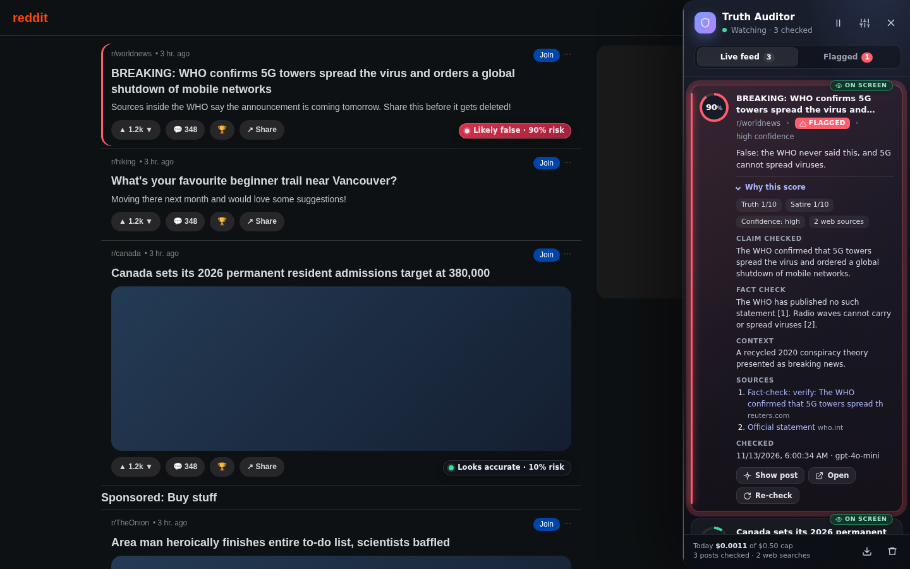
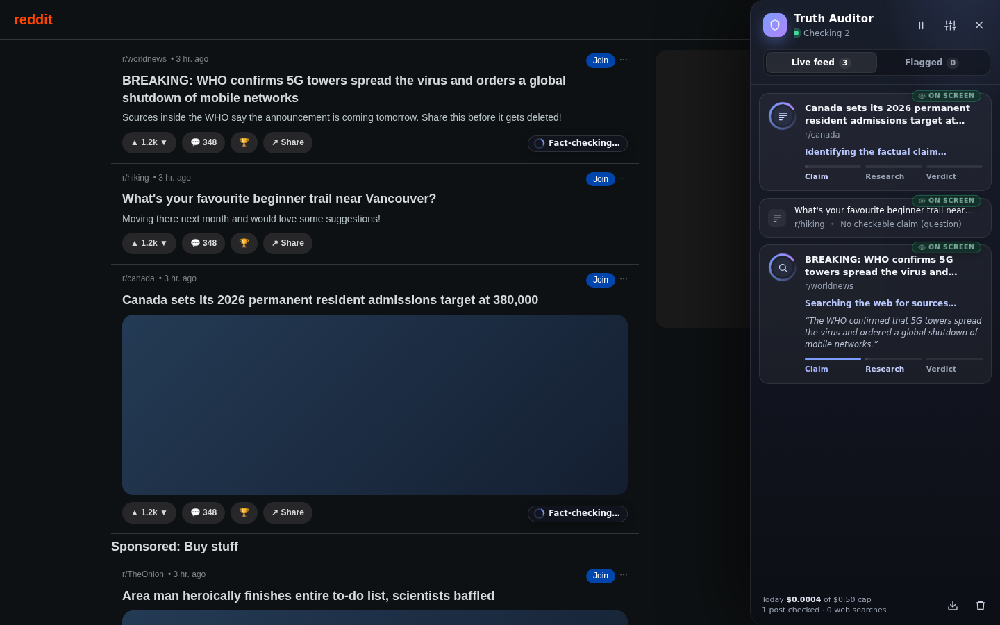
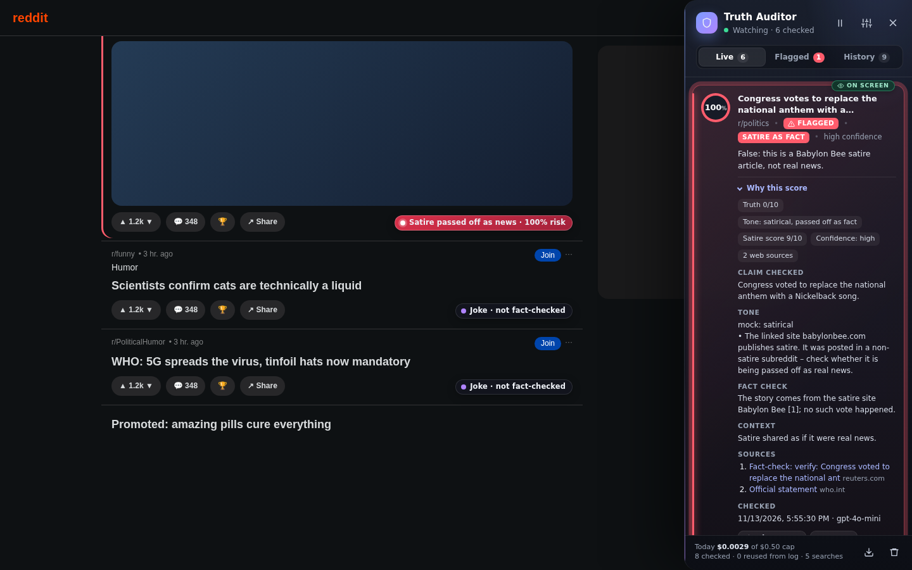
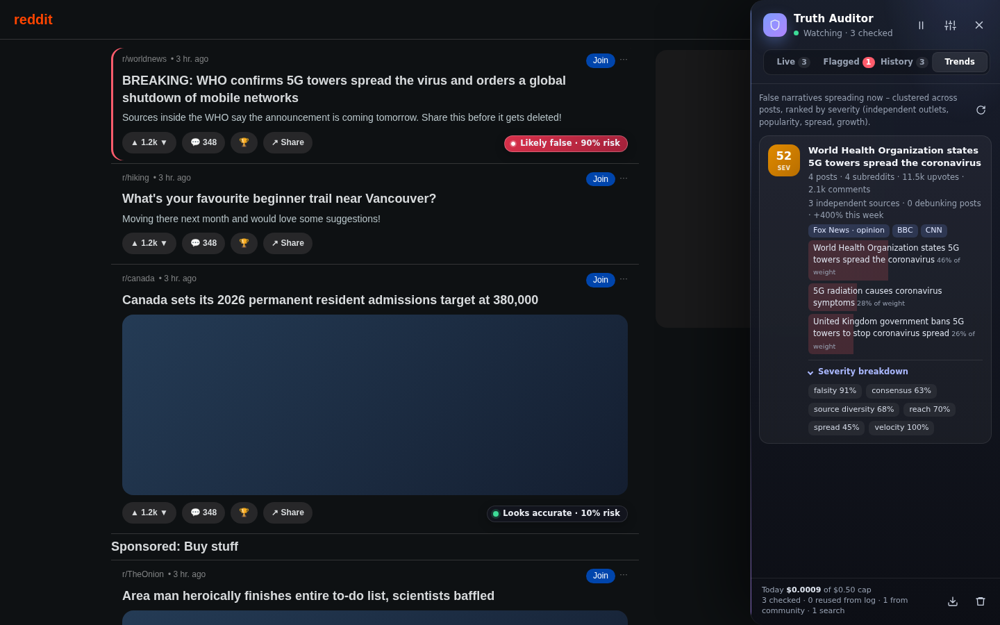
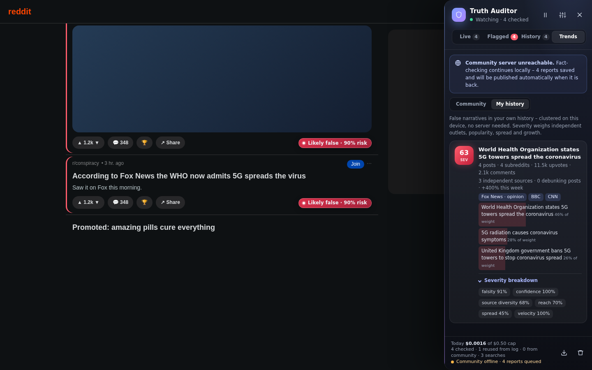
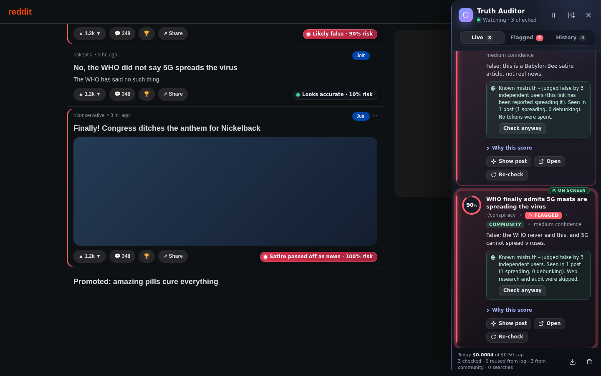
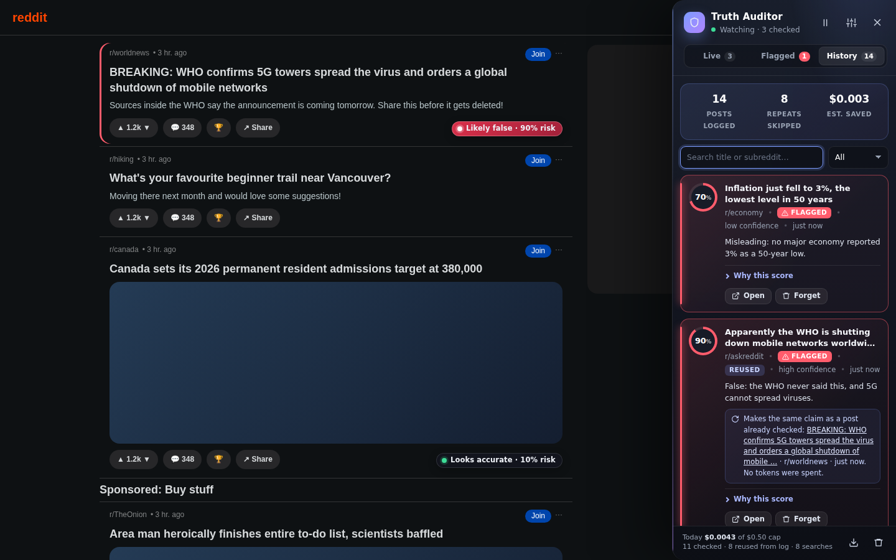

# Userscript guide

### Install (2 minutes)

1. Install the **[Tampermonkey](https://www.tampermonkey.net/)** extension (Chrome, Edge, Firefox, Safari, Opera). Violentmonkey also works.
   - Chrome/Edge: Tampermonkey also needs **“Allow User Scripts”** switched on (Extensions → Tampermonkey → Details), or *Developer mode* on older versions.
2. Open **[`reddit-truth-auditor.user.js`](https://raw.githubusercontent.com/pjvjay/reddit-truth-auditor/main/dist/reddit-truth-auditor.user.js)** (raw file). Tampermonkey shows an install page → **Install**.
   *(Or: Tampermonkey dashboard → “+” → paste the file contents → Save.)*
3. Go to [reddit.com](https://www.reddit.com). The panel opens on first run – paste your **OpenAI API key**, optionally a **[Tavily](https://tavily.com) key** for live web research, and press **Save**.

That's it – browse normally.

### What it does

| | |
|---|---|
| **Watches what you read** | A post is checked once it has been on screen for ~1 s (configurable), so fast scrolling doesn't burn credits. Works on the new Reddit UI, `old.reddit.com`, feeds, subreddits and post pages. |
| **Same pipeline as `batch/finalrun.py`** | ① LLM extracts the verifiable claim + search query → ② Tavily web research (the search engine GPT-Researcher uses) → ③ LLM audit returning `truth_score`, `satire_score`, `tone`, `presented_as_fact`, `factual_check`, `context_check`, `verdict`. Step ① also returns the canonical claim used for matching and community reports. Opinions, questions and memes are skipped after step ①. |
| **Side panel** | A glassy panel slides in from the right (25 % of the screen, min 340 px) with a spinning card for every post being researched (*Claim → Research → Verdict*), then a risk gauge, verdict, sources and “Show post” for each result. |
| **Configurable risk alert** | `risk = 100 − truth_score × 10`. The panel **auto-opens when a post at or above your threshold is on screen** (default 60 % ⇔ truth ≤ 4/10). |
| **Canonical claims** | Every checkable claim is also restated as *subject · predicate · object · polarity · numbers* and hashed to a **proposition key**, so reworded reposts – and posts *debunking* a claim – are recognised as the same proposition. |
| **Community network (opt-in)** | Share anonymous reports of mistruths with a community server and use the community's list of agreed mistruths. See [below](#community-network-optional). |
| **Understands humour, sarcasm & satire** | Sarcasm is decoded so the author's *intended* meaning is fact-checked; evident satire and jokes are discounted; satire **passed off as real news** is flagged. See [below](#humour-sarcasm--satire). |
| **Badges on posts** | Each checked post gets a small pill (*Fact-checking… / Looks accurate / Misleading? / Likely false*), and flagged posts get a red edge. Click a pill to open its card. |
| **Research log – never pays twice, works offline** | Every analysed post (scores, verdict, sources) is kept in a local log (30 days / 5,000 posts by default, shared across tabs). Posts already in the log are never re-analysed, and reposts are recognised – see below. A **History** tab lets you browse/search the log and shows how much was saved. |
| **Offline-first community sharing** | Analyses never depend on the community server. Reports are queued in the research log and published whenever the server is reachable – see [Offline-first](#offline-first). |
| **Cost controls** | Daily spend cap (default $0.50), parallel-check limit, pause button, subreddit allow/block lists. Today's spend and reuse count are shown in the panel footer. |
| **CSV export** | Download the research log as CSV (same columns as `final_policy_audit.csv`, plus risk, sources, `reused_from` / `reuse_via` and `tone` / `presented_as_fact` / `effective_risk`). |

### Humour, sarcasm & satire

Tone is judged from free local signals first, then by the model (extraction step) and again by the audit with the web research in hand (e.g. results revealing that a story originates from a satire site).

**Local signals (free):** ~25 known satire sites (The Onion, Babylon Bee, The Beaverton, ClickHole, Borowitz Report, NewsThump, Der Postillon…), satire subreddits (r/TheOnion, r/BabylonBee, r/\*circlejerk, r/SubredditSimulator…), humour/meme subreddits, `/s` · `/j` tone markers, “[Satire]” title labels and humour flairs. r/nottheonion is recognised as *real* news that only sounds absurd. These hints are passed to the model.

| Tone | What happens | Risk used for alerts |
|---|---|---|
| **Sincere** | Normal fact-check | full |
| **Sarcastic** | The model rewrites the claim to what the author actually means (“vaccines *totally* contain microchips /s” → “vaccines do not contain microchips”) and that is audited – no false alarm for people mocking a myth | full (of the intended meaning) |
| **Satire / joke, evident** | Posts in satire subreddits are skipped **without any API call**; other evident jokes stop after the cheap extraction call (no web search / audit). Badge: *Satire · not fact-checked*. **Check anyway** runs a full audit | literal risk × 0.2 |
| **Satire / joke passed off as fact** | e.g. a Babylon Bee headline posted sincerely in r/politics – fully audited and labelled **Satire passed off as news** | full |

Turn off *Treat evident satire & jokes as harmless* to audit and flag everything by its literal truth (posts already skipped on the page are re-checked).

### Community network (optional)

Off by default. When enabled (*Settings → Community network*, plus a server URL – anyone can host the [reference server](community-api.md)):

1. **Publish:** claims you found to be false are sent, in batches, as anonymous reports – canonical claim + verdict + hashed post id / link + subreddit + day, plus public post metadata: the linked outlet's host and article kind (news / opinion / …; never the URL path), an outlet the post cites, the post's upvotes / comments / crossposts and creation day. No post text, usernames or browsing history; *What exactly is shared?* in Settings shows the real payload.
2. **Aggregate:** the server merges reports into propositions (exact key, plus near-identical wording as aliases), tracks **how often each mistruth is spread vs. debunked**, where, and how fast, and computes a consensus. A proposition is only published once several **independent** users agree it's false.
3. **Share:** every client downloads that list periodically and matches posts **on the device** – a known spreading link costs zero tokens; a reworded claim costs only the small extraction call; posts *debunking* a known lie are shown as accurate. Results labelled *Community* always have a **Check anyway** button.
4. **Narratives:** the server clusters related false claims into event narratives (weighted DBSCAN over the canonical claims), biased towards lies carried by **several independent outlets** (CNN, Fox News, BBC… – counted by ownership group, news vs. opinion pieces distinguished) and by **popular posts** (upvotes, comments, crossposts), and gives each a severity score. Matching posts show *Part of a false narrative* / *Widespread false narrative*, and the **Trends** tab lists the most severe narratives with each claim's share of the weight. Details: [community-api.md §4](community-api.md#4-event-clustering--which-lies-are-propagating-and-how-severe).

### Offline-first

The community server is never required:

- **Everything is analysed and stored locally.** Fact-checks, duplicate detection, the History tab, CSV export and the **Trends → My history** narratives (the same clustering algorithm as the server, run on your own research log) all work without it.
- **Reports queue in the research log.** A result worth reporting is marked *pending* when it is stored – even before you join the network or while the server is down – together with the public post metadata needed to build the report later (so it carries the day you *saw* the post, not the day it was sent).
- **Published automatically when possible:** on start-up, every minute, when the browser comes back online, when new results arrive, after settings change, or on demand (*Settings → Publish now*, or the userscript-manager menu).
- **Failure handling:** unreachable / 5xx / 429 → kept and retried with exponential back-off (30 s – 1 h); a rejected publishing token → kept and paused until the settings change; a report the server refuses → isolated one by one and skipped; reports over the server's daily limit → kept in the queue and sent after the limit resets (the panel footer and *Settings → Community network* say how many are waiting and until when). A cross-tab lock stops two tabs sending the same reports.
- **Cached community data:** the list of known mistruths and the latest narratives are stored locally, so matching and the Trends tab keep working offline (marked as cached).
- *Settings → Community network* shows the connection state and queue, with **Publish now** and **Discard queue**. *Also share analyses made while offline or before I joined* decides whether a backlog is shared when you first connect.

### Research log & duplicate detection

Before a post costs anything it is matched against the log, cheapest check first:

| Tier | Match | Cost |
|---|---|---|
| 0 | **Same post** seen before (any tab, any earlier session) | free |
| 1 | **Crosspost** of a logged post (`crosspost_parent`) | free |
| 1 | **Same link** – URL normalised (tracking params, `www`/`m.`/AMP, `youtu.be`, trailing `/`) plus a loosely similar title | free |
| 1 | **Near-identical text** – title + start of body, word-overlap ≥ the *Duplicate similarity* setting (default 80 %) | free |
| 2 | **Same proposition** – identical canonical proposition key; a post taking the *opposite* stance reuses the verdict with the truth score inverted | 1 small call; web research + audit skipped |
| 2 | **Same claim** – after the cheap claim-extraction call the claim is compared with logged claims (word-overlap), and the extraction model is shown up to 5 related earlier claims and asked whether this post makes *materially the same* claim | 1 small call; web research + audit skipped |

Safeguards: two texts are never treated as duplicates if their **numbers differ** (“inflation fell to 1 %” ≠ “… 3 %”) or one is **negated** (“does” ≠ “doesn't”), and very short titles only match word-for-word. Identical posts that appear on screen together are checked once (the second waits for the first).

Duplicates must also share the same **tone**: the free tiers require the same framing (plain / `/s` sarcasm / humour / satire subreddit / satire link elsewhere), so “5G spreads the virus /s” never inherits the verdict of the sincere post with the same words, and an Onion link in r/TheOnion is not reused for the same link posted as news in r/politics. Claim-level matches require the same tone class (sincere vs. joke vs. joke-passed-off-as-fact) – even if the model says the claims are the same.

Reused results are labelled **Reused** with a link to the original post and a **Check anyway** button that ignores the match and runs a full check. The History tab can **Forget** individual entries; *Settings → Advanced → Clear research log* wipes it.

### Settings (⚙ in the panel, or Tampermonkey menu → *Settings…*)

| Setting | Default | Notes |
|---|---|---|
| OpenAI API key | – | Stored in Tampermonkey storage only; never written back into the page. |
| Model / API base URL | `gpt-4o-mini` / OpenAI | Any OpenAI-compatible endpoint (OpenRouter, local Ollama `http://localhost:11434/v1`). |
| Tavily API key | – | Optional. Without it the model's own knowledge is used and it is told to mark unverifiable recent news as *unverified*, not *false*. |
| **Risk threshold** | **60 %** | Slider 5–100 %. Lower = more sensitive. Changing it re-evaluates existing results instantly (no new API calls). |
| Open panel automatically | When a risky post is on screen | or *whenever posts are being researched*, or *never* (the launcher tab just shows a red count). |
| Treat evident satire & jokes as harmless | on | Their risk is discounted 80 % – unless they're passed off as real news. Sarcasm is always decoded. |
| Don't spend tokens on satire subreddits | on | r/TheOnion, r/BabylonBee, r/\*circlejerk… are skipped without an API call. |
| Check after on-screen for | 1200 ms | Dwell time before a post is checked. |
| Parallel checks | 2 | |
| Daily spend cap | $0.50 | 0 = no cap. Estimated from token usage and the per-token prices under *Advanced*. |
| Reuse verdicts for near-duplicates | on | Crossposts, same link, near-identical text, same claim. |
| Duplicate similarity | 80 % | 50–100 %. Higher = stricter; 100 % = identical wording only. |
| Keep research log | 30 days | Entries older than this are re-analysed if seen again. |
| Max posts in log | 5,000 | Oldest entries are dropped first. |
| Join the community network | off | Needs a community server URL (and a publishing token if that server requires one). |
| Share anonymous reports / include subreddit | on / on | Only when joined. |
| Also share analyses made while offline or before joining | on | Off: only results produced after joining are shared. |
| Use community verdicts | on | Known mistruths skip web research & audit. |
| Independent reporters required | 3 | Minimum number of different users before a community verdict is used. |
| Only / never these subreddits | – | Comma-separated, like `TARGET_SUBS` in the Python scripts. |
| Reference facts | – | Ground-truth notes injected into the audit prompt (the "MASTER REFERENCE" idea from `test.py`). |

Shortcuts: **Alt+Shift+R** toggles the panel, **Esc** closes it.

### Cost

Each post with a checkable claim uses two `gpt-4o-mini` calls (roughly $0.0003–0.0007 together) plus one Tavily search (the free tier currently includes 1,000 searches/month). Posts without a claim cost one small call. Posts already in the research log, crossposts, same-link and near-identical reposts cost nothing; same-claim reposts cost only the small extraction call – so the default $0.50/day cap covers around 1,000 checked posts.

### Privacy & limitations

- Post text is sent to your LLM provider (and the search query to Tavily). Nothing else leaves your browser unless you join the community network, which only sends the anonymous report fields listed in [server/README.md](privacy.md). The research log lives in your userscript manager's local storage.
- The script declares `@connect *` so it can reach the community server / custom LLM endpoint *you* configure; Tampermonkey asks for confirmation the first time a new domain is used.
- LLM fact-checking can be wrong – treat the panel as a prompt to look closer, not a final ruling. Check the sources under *Why this score*.
- A reused verdict is as old as the original check. For fast-moving stories, lower *Keep research log* or use **Check anyway**.
- Only post titles/bodies are checked (not comments, images or videos). Link posts are judged on their headline.
- Reddit changes its markup from time to time; if badges stop appearing, update the script.

### Updating

Tampermonkey checks `dist/reddit-truth-auditor.meta.js` for new versions and updates automatically. Your research log, settings and queued reports are kept across updates; storage migrations (e.g. the v1.0 cache and the v1.3 outbox) run automatically.

